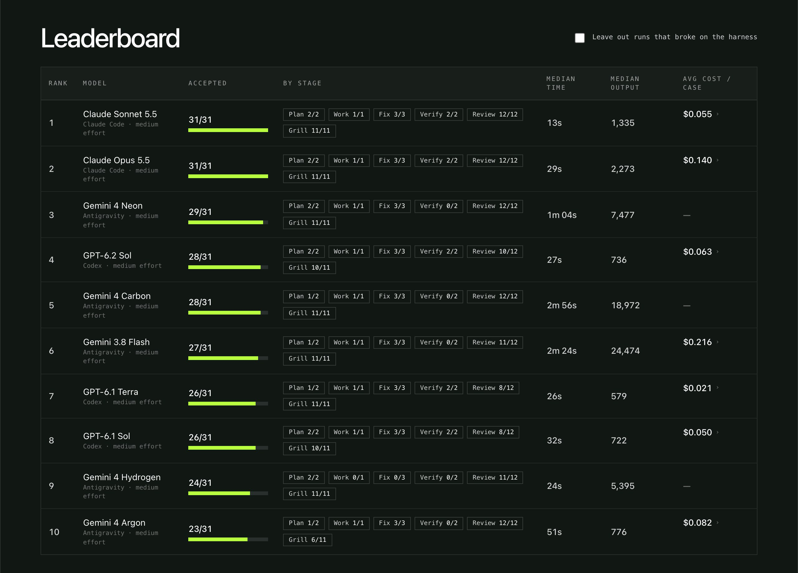

I've benchmarked models on this blog before: [Opus 4.6 against 4.7](), [Fable 5](), [Fable 5.1 against GPT-6 Astra](). Those were puzzle suites: one prompt, one answer, a score. That is not how models are used on datacrash.io. There, a model plans a card, implements it, fixes review findings, resolves conflicts, reviews other changes, challenges plans and verifies the result in production. Each of those stages runs in its own sandbox, with its own rules and its own way to fail.

So the question worth answering is not "which model is best" but **which model for which stage, and at what price per task**. The results are public and update live at [datacrash.io/bench](https://datacrash.io/bench). This post explains how the benchmark is built and what the first full round says.

<!-- readmore -->

## The benchmark: thirty-one tasks from the platform's own stages

The benchmark is a dedicated repository of small, self-contained tasks. Each one is a copy of something agents do every day:

- **Plan (2):** plan a bug fix and name the module to change; recognise a card only a person may decide.
- **Work (1):** implement an approved plan, graded by a hidden test.
- **Fix (3):** fix review findings on a pull request; resolve a merge conflict in code; resolve two database migrations with the same number. All three are graded by hidden tests.
- **Verify (2):** check a Definition of done that is met, and one that isn't.
- **Review (12):** find a seeded defect, or approve a clean change. The defects are a cache key without the tenant, an interpolated SQL offset, an off-by-one at a size limit, a parser message echoed to the client, an unescaped HTML attribute and a host check by string prefix. Six clean pull requests look like those but are correct.
- **Grill (11):** attack a plan before any code is written. Eight plans carry a seeded flaw: the wrong module, a Definition of done item nobody can check, "watch it for 24 hours" instead of an alert, a hidden step only the owner can do, a schema change with nothing for existing rows, a phase too big for one run, a plan against the repository's own rules, and a missed edge case the card names. Three plans are sound, two of them deliberately close to a flawed one.

Two of those stages are balanced on purpose. A reviewer that flags everything would find all six defects and fail all six clean pull requests. A plan critic that blocks everything would fail the three sound plans. Grill also checks that every objection carries real evidence, either a file and line that exist or an exact quote, so an invented objection fails.

Every model runs behind its production harness, in the same sandbox as real work: Claude models through Claude Code, GPT through Codex, Gemini through Antigravity. Every variant in this round runs at **medium** effort. A bench run that never asks for an effort runs at medium too, so "default" and "medium" are one variant, not two.

## The first full round

*The live leaderboard at [datacrash.io/bench](https://datacrash.io/bench). Click a cost for its split by stage; the page also shows every task for every model.*

| Model (harness) | Accepted | Plan | Work | Fix | Verify | Review | Grill | Avg cost / task |
|---|---|---|---|---|---|---|---|---|
| Claude Sonnet 5.5 (Claude Code) | **31/31** | 2/2 | 1/1 | 3/3 | 2/2 | 12/12 | 11/11 | $0.055 |
| Claude Opus 5.5 (Claude Code) | **31/31** | 2/2 | 1/1 | 3/3 | 2/2 | 12/12 | 11/11 | $0.140 |
| Gemini 4 Neon (Antigravity) | 29/31 | 2/2 | 1/1 | 3/3 | 0/2 | 12/12 | 11/11 | no list price |
| GPT-6.2 Sol (Codex) | 28/31 | 2/2 | 1/1 | 3/3 | 2/2 | 10/12 | 10/11 | $0.063 |
| Gemini 4 Carbon (Antigravity) | 28/31 | 1/2 | 1/1 | 3/3 | 0/2 | 12/12 | 11/11 | no list price |
| Gemini 3.8 Flash (Antigravity) | 27/31 | 1/2 | 1/1 | 3/3 | 0/2 | 11/12 | 11/11 | $0.216 |
| GPT-6.1 Sol (Codex) | 26/31 | 2/2 | 1/1 | 3/3 | 2/2 | 8/12 | 10/11 | $0.050 |
| GPT-6.1 Terra (Codex) | 26/31 | 1/2 | 1/1 | 3/3 | 2/2 | 8/12 | 11/11 | **$0.021** |
| Gemini 4 Hydrogen (Antigravity) | 24/31 | 2/2 | 0/1 | 0/3 | 0/2 | 11/12 | 11/11 | no list price |
| Gemini 4 Argon (Antigravity) | 23/31 | 1/2 | 1/1 | 3/3 | 0/2 | 12/12 | 6/11 | $0.082 |

*One attempt per task, all at medium effort. Cost is the mean per task at each provider's public API prices, cache reads and writes included. It is a way to compare models, not what the platform pays. Three Gemini models have no public price yet.*

### Two models with a clean sheet, at very different prices

Sonnet 5.5 and Opus 5.5 both accepted every task. Opus wrote about 70% more output per task and took roughly twice as long, and it cost **2.5 times as much** for the same result. On a benchmark this size that does not prove the models are equal. It does say what has to be shown before the more expensive one gets a stage: a task Sonnet fails and Opus passes. Until such a task exists, the default goes to the cheaper model.

### Price per token is not price per task

Gemini 3.8 Flash has the lowest price per token of all the priced models here, and it is the **most expensive per task**: $0.22, about four times Sonnet. It wrote a median of about 24,000 output tokens per task, against about 1,300 for Sonnet and under 800 for GPT-6.2 Sol and Gemini 4 Argon. A model that thinks out loud at length pays for every token of it, at any price.

GPT-6.1 Terra is the opposite: the cheapest model on the board at **about two cents a task**, with short answers and few turns. It passed every Fix and Verify task. It missed one Plan task, and the rest of its misses are in Review, on both sides: it approved a change with a tenant-less cache key, missed the echoed parser message in another, and raised a serious finding on two clean ones. That is the profile of a model that is useful for well-specified stages and risky as a reviewer.

The two GPT generations make the same point from another side. GPT-6.1 Sol missed the same two defects as Terra, while GPT-6.2 Sol found every seeded defect, for about a cent more per task ($0.063 against $0.050). For Review, the newer model is worth the difference; for Fix and Verify, where all three GPT models passed everything, it is not yet shown to be.

### Review fails more often on false alarms than on missed bugs

Most models found every seeded defect. Where Review scores drop, the cause is more often a **serious finding on a clean pull request** than a missed defect: all three GPT models and Gemini 3.8 Flash did this. A false block is not a cheap mistake. It sends a correct change back for a fix, a new CI run and another review. That is why a block has to describe a concrete failure scenario ([more on that in the previous post]()), and why the bench counts the clean cases exactly as much as the broken ones.

### Identical failures point at the harness, not the model

All five Gemini models failed both Verify tasks, and nine of those ten attempts ended without producing a verdict at all, so there was nothing to grade. Five different models failing the same way on one stage, while passing harder stages, is a property of the integration (how the harness is asked for a verdict and how it returns one), not of any of the models. Those cells say nothing about Gemini's ability to verify yet. The same reasoning applies to Gemini 4 Argon's Grill score: in five of its eleven attempts the answer did not have the required shape, which is a contract problem before it is a quality problem.

This is why the page separates a **rejected** answer (the model answered and was wrong) from a **harness error** (there was nothing to grade), and lets the reader leave harness errors out of the score.

### Grill needs harder plans

Seven of the ten variants caught every flawed plan and left every sound one alone. Both GPT Sol models missed the same flaw (a phase too big for one run), and Gemini 4 Argon's misses were the format problem above. That says the current grill tasks are below the level where models differ. The stage stays, because its job is to keep plans from reaching Work with a flaw in them. But the benchmark needs harder plans, with flaws that only show up when the critic reads the code and not just the plan.

## What this means for choosing a model

Together, these results give five rules for choosing a model:

1. **Per stage, never globally.** A model that reviews well can still fail to merge a migration conflict, and a model that plans well can still miss a hidden test. Each stage should get its own choice of model, and every run records which provider, model and effort did it, so that choice can be checked.
2. **Measure the model and its harness together.** The same model behaves differently behind a different agent. A failure shared by every model behind one harness is fixed in the harness (its prompt, its tools, its output contract), not by changing models.
3. **Compare cost per task, not price per token.** Output length dominates. The benchmark records the tokens of every run, so each stage's cost comes from what the model actually used, not from a guess at how much it will write.
4. **False alarms count as much as misses.** A reviewer's hit rate on bad changes and its silence on good ones are scored together, because both cost a full loop of fix, CI and review.
5. **The cheaper model keeps a stage until a task shows otherwise.** A more expensive model gets a stage only when the benchmark has a task it passes and the cheaper one fails.

## What comes next

- **Ten tasks in every stage.** Today one Work task decides Work and two decide Verify, so one miss moves a stage by half or more. With ten per stage every score reads as a share, and one miss is ten points, not fifty.
- **More attempts per task.** One attempt is a direction, not a verdict; three per task is the minimum for a score worth defending.
- **Effort as a dial.** Low and high effort for the models above, to see which stages can run cheaper without losing tasks.
- **More models:** Claude Haiku 5.5 and the self-hosted open models, on exactly the same tasks.
- **Harder grill plans,** with flaws visible only in the code, so that stage separates the models too.

The table at [datacrash.io/bench](https://datacrash.io/bench) updates as these runs land.

If you're investing in or building in this space, or want to see how this would work on your own repositories, write to me at [3h4x@datacrash.io](mailto:3h4x@datacrash.io).
